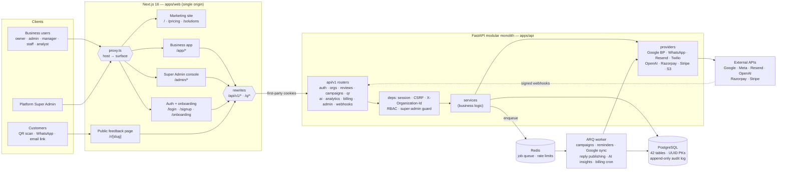
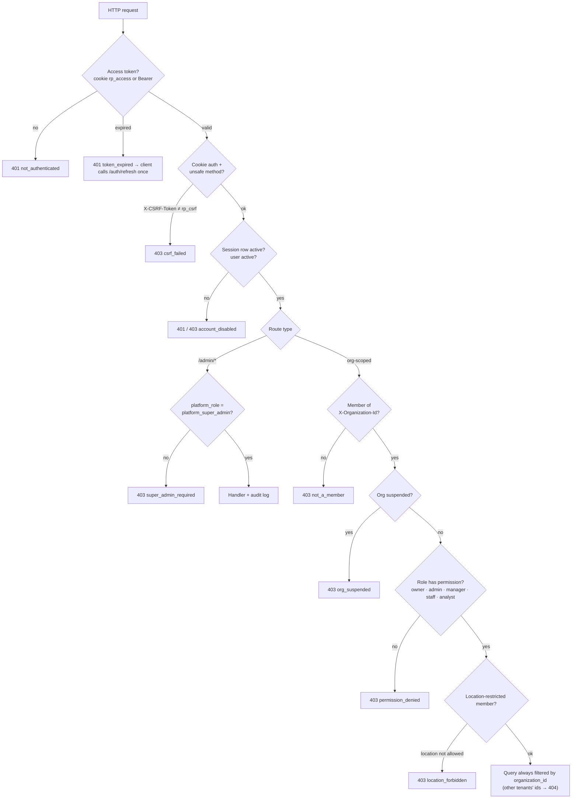
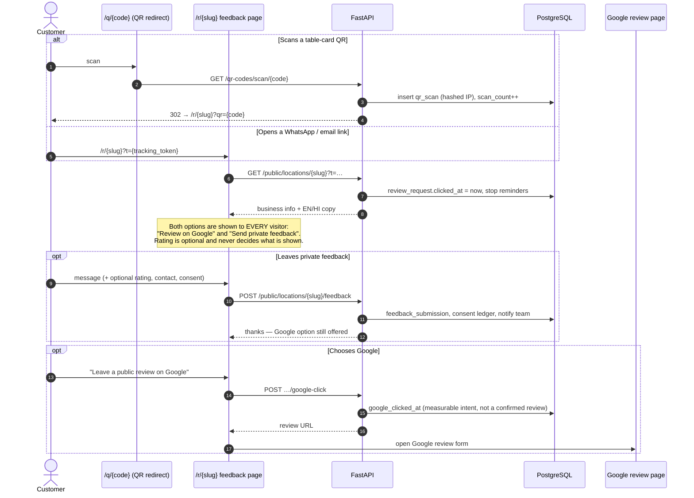
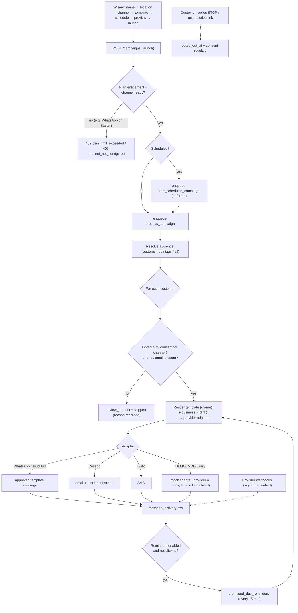
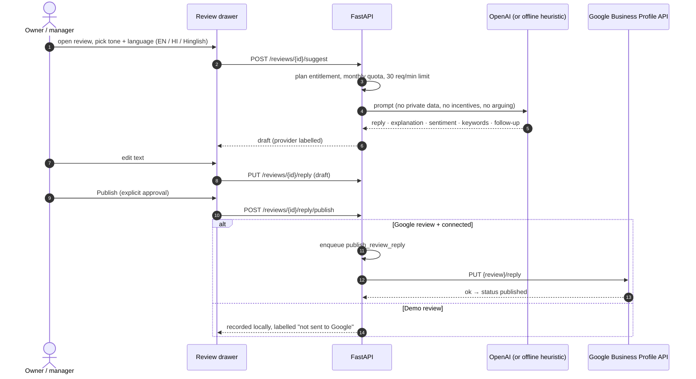
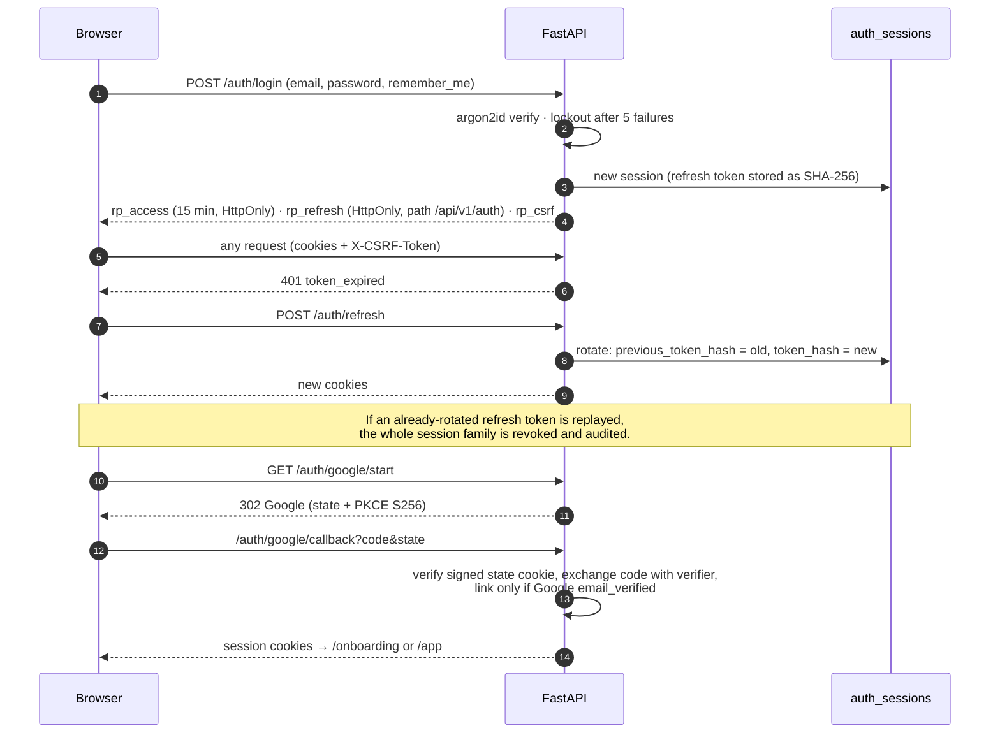
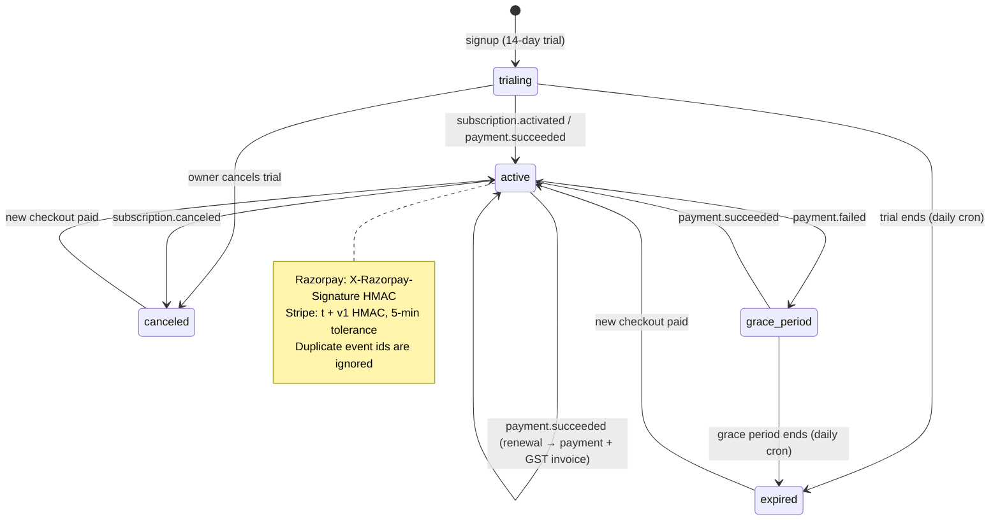
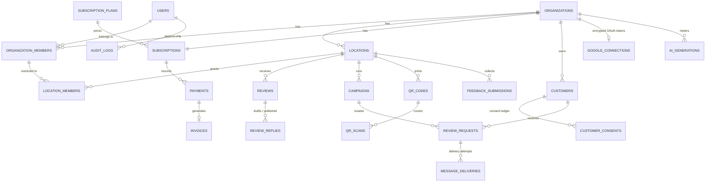

# ReviewPilot AI

**Turn Customer Experiences Into Business Growth.**

    

[](https://render.com/deploy?repo=https://github.com/aqkprogrammer/reviewpilot-ai)

ReviewPilot AI is a multi-tenant reputation-management SaaS for local businesses (restaurants,
clinics, salons, hotels, agencies…), India-first. It collects genuine customer feedback over
**WhatsApp, QR, email and SMS**, syncs Google reviews through the official Business Profile API,
drafts owner replies with AI (English, Hindi, Hinglish), and turns review text into
customer-feedback intelligence.

Three surfaces ship from one Next.js app, each with server-enforced authorization:

| Surface | Production host | Path in dev | Who |
| --- | --- | --- | --- |
| Marketing site + auth | `reviewpilot.ai` | `/`, `/pricing`, `/login`… | Everyone |
| Business application | `app.reviewpilot.ai` | `/app/*`, `/onboarding` | Org owners, admins, managers, staff, analysts |
| Super Admin console | `admin.reviewpilot.ai` | `/admin/*` | `platform_super_admin` only |

Public customer pages: `/r/{location-slug}` (feedback page) and `/q/{code}` (QR scan redirect).

## Product principles (enforced in code)

- **No review gating.** Every visitor sees the same “Leave a public review on Google” option,
  regardless of rating or private feedback (`app/api/v1/public.py`, covered by tests).
- **No incentives.** Message templates mentioning gifts/coupons/“5-star” are rejected.
- **Consent first.** Review requests are only sent with a recorded consent for that channel;
  opt-outs (link, `STOP` reply, dashboard) are honoured everywhere.
- **AI never auto-publishes.** Suggestions are drafts until a human publishes them.
- **No fake integrations.** Missing credentials show setup states. Demo mode is explicit:
  seeded rows carry `is_demo` / `source="demo"` / `provider="mock"` and the UI labels them.

## Architecture

> The diagrams below are [Mermaid](https://mermaid.js.org/) — GitHub renders them interactively (use the
> pan / zoom controls on each diagram). Expand the ▸ sections for each workflow.



### Multi-tenancy & authorization



<details>
<summary><b>▸ Review collection workflow (QR · WhatsApp · email) — no review gating</b></summary>


</details>

<details>
<summary><b>▸ Campaign engine (consent-checked delivery, reminders, webhooks)</b></summary>


</details>

<details>
<summary><b>▸ AI review reply workflow (human approval required)</b></summary>


</details>

<details>
<summary><b>▸ Authentication: login, refresh-token rotation and reuse detection</b></summary>


</details>

<details>
<summary><b>▸ Subscription state machine (changed only by verified webhooks)</b></summary>


</details>

<details>
<summary><b>▸ Core data model</b></summary>



All 42 tables are documented in [docs/DATABASE.md](docs/DATABASE.md).
</details>

Details: [docs/ARCHITECTURE.md](docs/ARCHITECTURE.md).

## Repository layout

```
reviewpilot-ai/
├── apps/
│   ├── web/            Next.js 16 app (marketing, business app, admin, public pages)
│   ├── api/            FastAPI + SQLAlchemy 2 async + Alembic; also contains worker code
│   └── worker/         Worker Dockerfile + README (runs apps/api/app/worker)
├── packages/
│   ├── shared-types/   Roles, permissions, enums shared with the API
│   └── ui/             Design tokens (tokens.css) + chart/motion tokens
├── infrastructure/     Railway service configs
├── render.yaml         Render Blueprint (web, API + worker, Postgres, Key Value)
├── docs/               Architecture, database, API, auth, integrations, deployment…
├── docker-compose.yml  Postgres, Redis, migrate+seed, API, worker, web
├── Makefile
└── .env.example
```

## Quick start (local)

Prerequisites: Node 22+, pnpm 10+, Python 3.12+ with [uv](https://docs.astral.sh/uv/),
PostgreSQL 15+ (17 recommended), Redis 7 (optional in development).

```bash
cp .env.example .env                       # dev defaults work out of the box
createuser -s reviewpilot 2>/dev/null; psql -d postgres -c "ALTER ROLE reviewpilot WITH LOGIN PASSWORD 'reviewpilot'"
createdb -O reviewpilot reviewpilot && createdb -O reviewpilot reviewpilot_test
make install                               # pnpm install + uv sync
make migrate                               # alembic upgrade head
make seed-demo                             # plans, templates + sample data (dev only)
make dev                                   # API :8000 + web :3000
make worker                                # optional; without Redis jobs run inline
```

Open http://localhost:3000. API docs: http://localhost:8000/api/v1/docs.

### With Docker

```bash
docker compose up --build
```

Runs Postgres, Redis, a one-shot `migrate` service (migrations + seeds), API, worker and web.

## Demo credentials (development only)

Created by `make seed-demo`. Passwords come from `SEED_PASSWORD_*` (defaults below). The seed
command refuses to run in production, and the production config validator refuses `DEMO_MODE`.

| Role | Email | Password |
| --- | --- | --- |
| Business owner (Spice Route Kitchen, 3 locations) | `owner@reviewpilot.dev` | `Owner@12345` |
| Organization admin | `admin@reviewpilot.dev` | `Admin@12345` |
| Staff | `staff@reviewpilot.dev` | `Staff@12345` |
| Platform Super Admin | `superadmin@reviewpilot.dev` | `SuperAdmin@12345` |

The demo seed also creates five other sample organizations (dental, salon, hotel, real estate,
coaching) in different subscription states for the admin console.

## Running each piece

| Piece | Command |
| --- | --- |
| API | `cd apps/api && uv run uvicorn app.main:app --reload --port 8000` |
| Web | `pnpm --filter @reviewpilot/web dev` |
| Worker | `cd apps/api && uv run arq app.worker.settings.WorkerSettings` |
| Migrations | `cd apps/api && uv run alembic upgrade head` |
| First Super Admin | `cd apps/api && uv run python -m app.cli create-super-admin --email you@company.com --name "You" --secret "$SUPER_ADMIN_BOOTSTRAP_SECRET"` |

## Tests

```bash
make test-api     # pytest against the reviewpilot_test database (rebuilt each run)
make test-web     # vitest unit/component tests
make e2e          # Playwright (needs API with OAUTH_MOCK_ENABLED=true + web running)
```

## Integrations that need credentials or provider approval

| Integration | Needed | Without it |
| --- | --- | --- |
| Google Sign-In | OAuth client (`GOOGLE_CLIENT_ID/SECRET`) | Button shows “not configured” |
| Google Business Profile | Same OAuth client **and** Google's Business Profile API access approval | Manual review-link per location |
| WhatsApp Cloud API | Meta app, WABA, phone number ID, token, **approved templates** | Simulated in demo mode, otherwise unavailable |
| Email | `RESEND_API_KEY` + verified domain | Dev outbox (`/api/v1/dev/outbox`) |
| SMS | Twilio (or a DLT-registered Indian provider) | Simulated / unavailable |
| OpenAI | `OPENAI_API_KEY` | Offline heuristic generator, labelled as such |
| Payments | Razorpay and/or Stripe keys + webhook secrets | Signed mock checkout in demo mode only |
| Storage | S3-compatible bucket | Local disk |

## Deploy to Render

`render.yaml` is a Render Blueprint that creates **PostgreSQL**, **Key Value (Redis)**, the **API**
(migrations + seeds on boot, ARQ worker embedded on the free plan) and the **web** app in Singapore.

1. Click **Deploy to Render** above (or *New → Blueprint* and pick this repo).
2. When prompted, set `ENCRYPTION_KEY` to a Fernet key
   (`python -c "from cryptography.fernet import Fernet; print(Fernet.generate_key().decode())"`).
3. After the first deploy, set the public URLs and redeploy both services:
   - API: `FRONTEND_URL` and `CORS_ORIGINS` = web URL, `BACKEND_URL` = API URL
   - Web: `BACKEND_URL` = API URL (read at build time), `NEXT_PUBLIC_SITE_URL` = web URL

The blueprint runs with `ENVIRONMENT=demo`: seeded sample data, simulated messaging and payments,
offline AI — with generated secrets and secure cookies. The demo accounts use the passwords in the
table above (re-applied on every boot); they are public, so change `SEED_PASSWORD_*` if the instance
should not be openly accessible. For production set `ENVIRONMENT=production`, `DEMO_MODE=false`,
`SEED_DEMO_DATA=false`, add real integration keys, and move the worker to its own service.
Free-plan notes: services sleep when idle (and the embedded worker with them), free Postgres expires
after 30 days, and uploads are on ephemeral disk unless S3 is configured. See
[docs/DEPLOYMENT.md](docs/DEPLOYMENT.md).

## Documentation

[Architecture](docs/ARCHITECTURE.md) · [Database](docs/DATABASE.md) · [API](docs/API.md) ·
[Authentication](docs/AUTHENTICATION.md) · [Google](docs/GOOGLE_INTEGRATION.md) ·
[WhatsApp](docs/WHATSAPP_INTEGRATION.md) · [Payments](docs/PAYMENTS.md) ·
[Deployment](docs/DEPLOYMENT.md) · [Admin guide](docs/ADMIN_GUIDE.md) ·
[Development](docs/DEVELOPMENT.md)
